# Witcher TTS: история эксперимента

Предисловие от человека. Да, от человека! А вы чего ждали? Что в эпоху слопо-генераторов я сам статью напишу?)

Это немного не моя экспертиза, я все-таки классический погромист. С ML имел дело лишь на чемпионате дата-анализа городском *(кстати, получил 2 место :) )*, кто бы мог подумать, что обучить "говорилку" кратно сложнее чем "`pip install prophet` - ты молодец!". Все таки индустрия решила проблему предсказания временных рядом раньше и универсальней :(

## От «диалап-модема» к управляемой интонации — и почему мы остановились

Последнее обновление: 13 сентября 2026 года

Это не рекламное описание и не список удачных демо. Это история того, как мы пытались построить русскую озвучку персонажей *The Witcher 3*: что именно проверяли, какие ошибки постановки нашли, какие результаты можно считать настоящими, а какие пришлось вычеркнуть, и почему в конце остановили самодельную ветку.

Здесь собраны только результаты, которые нужны для понимания причинно-следственной цепочки.

> Важное правило чтения: численный loss — это диагностика обучения, а не гарантия того, что WAV произносит слова. В проекте окончательное решение принималось по двум независимым сигналам: метрики и прослушивание.

## 1. С чего начинали

Цель была сформулирована достаточно конкретно:

1. подать русский текст;
2. выбрать персонажа;
3. получить русскую речь с голосом этого персонажа;
4. позже добавить иностранную озвучку как источник ритма и интонации — так, чтобы английский или польский актёр подсказывал, *как сказать*, но не подменял русский текст и не подменял русского актёра.

Иными словами, требовалась не простая voice conversion. Нужно было разделить три вещи:

```text
русский текст       → содержание и произношение
ID русского героя   → тембр и голос
иностранный audio   → ритм, паузы, энергия, интонация
```

На первом этапе иностранная модальность сознательно не подключалась. Сначала требовалось доказать, что базовая модель умеет говорить по-русски.

### Датасет

Сначала был собран изолированный корпус на 25 083 записях и 10 персонажах: Geralt, Yennefer, Regis, Triss, Cirilla, Dijkstra, Baron, Zoltan Chivay, Shani и Vesemir. Для записей были подготовлены русские тексты, английские тексты, метаданные, speaker ID и параллельные аудиодорожки.

Позднее для отдельного масштабирования отобрали все speaker-группы с более чем 10 минутами русской речи. В рабочую постановку вошли 64 группы и 35 661 запись; `unknown` исключили, а `mirror` включили как потенциально атрибутируемого Гюнтера о’Димма. Это было уже другое распределение данных, поэтому его нельзя напрямую сравнивать с десятиспикерным корпусом без оговорок.

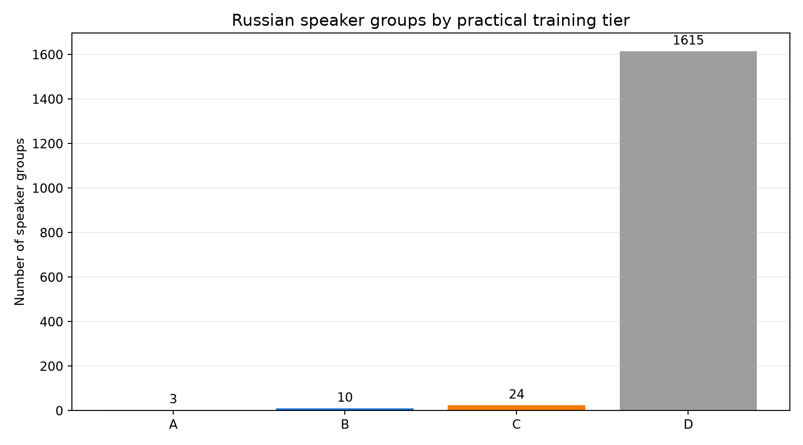

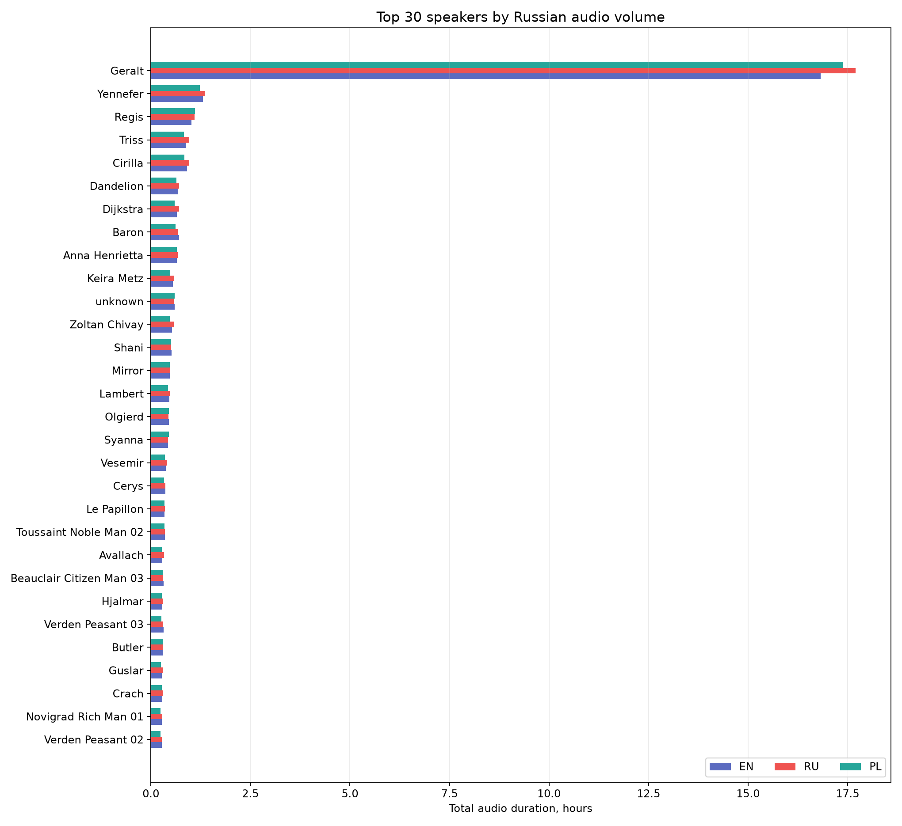

Главный перекос корпуса оказался существенным: у Geralt около 15,9 часа, у Yennefer около 1,2 часа, а остальные персонажи представлены десятками минут. Поэтому слово «много данных» в этой задаче не означает равномерный корпус: sampling и атрибуция влияют на обучение не меньше, чем число записей.

## 2. Первая катастрофа: неправильное mel-представление

Первый результат звучал как монотонный писк, иногда как модем. Причина оказалась не в «плохом голосе», а в несоответствии форматов: mel считался через `log1p(mel)`, а Vocos ожидал натуральный логарифм magnitude-mel.

Исправили преобразование на:

```python
torch.log(mel.clamp_min(1e-7))
```

После этого появился нормальный спектральный диапазон, а Vocos перестал быть подозреваемым. Позднее мы отдельно подали в Vocos настоящий target-mel из датасета — без текста, модели и speaker conditioning. Vocos oracle и оригинальный WAV на слух оказались идентичны. Это окончательно отделило проблему декодера от проблемы генератора: артефакты рождаются в acoustic-модели, а не в последнем вокодерном шаге.

Послушать контроль:

- [Geralt: настоящий WAV через Vocos oracle](/static/papers/witcher_tts/static/witcher_tts/samples/vocos_oracle_reconstruction_geralt_yennefer/geralt_vocos_oracle.wav)
- [Geralt: пересохранённый оригинал](/static/papers/witcher_tts/static/witcher_tts/samples/vocos_oracle_reconstruction_geralt_yennefer/geralt_original_24k.wav)
- [Yennefer: настоящий WAV через Vocos oracle](/static/papers/witcher_tts/static/witcher_tts/samples/vocos_oracle_reconstruction_geralt_yennefer/yennefer_vocos_oracle.wav)

## 3. Baseline: 16,5 миллиона параметров

Первой полноценной моделью был небольшой baseline примерно на 16,5M параметров. Внутри были текстовый encoder, посимвольные embeddings, свёрточный acoustic decoder, duration/prosody/speaker heads и Vocos на выходе. Модель должна была научиться связывать текст с mel, но реальное выравнивание текста с аудио не было встроено.

На полном корпусе после 100 000 шагов validation loss был около `2.5595`, raw mel-L1 — `2.5582`. На слух голос персонажа можно было узнать, но слова и слоги почти не сохранялись. Баслайн учил общую акустическую манеру и отдельные признаки голоса, но не устойчивое произношение.

При этом на искусственном наборе из 20 реплик baseline иногда запоминал знакомые фразы. Это был полезный, но очень узкий результат:

Для baseline не рисуется выдуманная «история loss»: численная контрольная точка полного запуска описана текстом, а рядом приведён только график raw Transformer.

> маленький набор можно выучить наизусть — ещё не значит, что модель умеет превращать произвольный русский текст в речь.

Контрольные WAV:

- [Baseline overfit: Geralt текст + Geralt голос](/static/papers/witcher_tts/static/witcher_tts/samples/known_text_grid/baseline_overfit20/geralt_1_geralt.wav)
- [Baseline overfit: та же реплика + Yennefer ID](/static/papers/witcher_tts/static/witcher_tts/samples/known_text_grid/baseline_overfit20/geralt_1_yennefer.wav)
- [VITS G6000: matching Geralt](/static/papers/witcher_tts/static/witcher_tts/samples/vits_overfit_20_g6000/geralt_1_geralt.wav)

## 4. Raw Transformer: стало лучше, но не стало речью

Следующим кандидатом стал Transformer Flow примерно на 44,36M параметров:

- шестислойный text Transformer;
- восьмислойный acoustic Transformer;
- cross-attention к тексту;
- speaker embedding;
- flow matching от шума к нормализованному log-mel;
- Euler sampling.

После 100 000 шагов validation flow loss составил около `0.3326`. В сравнении с baseline результат был лучше: голоса Geralt и Yennefer различались, иногда возникали речеподобные фрагменты. Но человеческой речи и стабильного содержания всё ещё не было — скорее акустическая заготовка с голосовым профилем.

Мы отдельно проверили 12, 32 и 64 flow-шага. 32 шага иногда давали чуть больше деталей, но содержание практически не менялось. Следовательно, проблема не заключалась в том, что sampler «недокрутил» траекторию. Увеличение числа шагов не возвращало слова.

График первой raw-ветки:

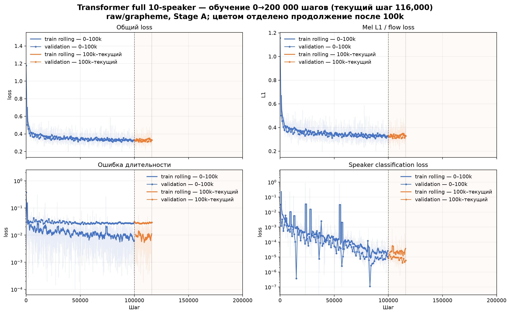

### Почему ранний эксперимент с 20 фразами запутал картину

Сначала часть WAV была сгенерирована не из маленьких overfit-checkpoint, а из полных моделей. Их сравнили как будто это одна и та же проверка. Позднее это исправили: matching и swapped режимы были пересозданы из правильных 20-репличных checkpoint.

После исправления стало видно, что старые «лучшие» впечатления нельзя обобщать. В корректной матрице baseline и Transformer сохраняли отдельные черты голосов, но слова и слоги оставались нестабильными. Позже отдельные `transformer_*_exact.wav` действительно показали речь-подобные фрагменты, но они зависели от seed и режима sampling. В статье они приведены как реальные qualitative-примеры, а не как доказательство полноценного TTS.

## 5. Графемы, фонемы и первая ошибка objective

Графема — это буква или текстовый символ. Фонема — условная запись звука, то есть попытка явно показать, как слово произносится. Например, русское «всё» в фонемном представлении содержит ударную гласную и согласные, а не просто последовательность букв `в-с-ё`.

Мы подключили готовый `espeak-ng` через `phonemizer`, не изобретая собственный G2P. Затем добавили CTC alignment, duration regulator и `x0` reconstruction loss. Это выглядело логичным: если сеть видит фонемы и временные границы, она должна лучше связывать звук с текстом.

Но первые численные результаты оказались обманчивыми. На 1500 шагах validation CTC был `0.026`, `x0=0.0047`, duration `0.055`. На слух фразы всё равно нельзя было связать с входным текстом.

Сохранились и сами WAV этого раннего прогона: [Geralt, dataset-фраза](/static/papers/witcher_tts/static/witcher_tts/samples/aligned_overfit_20_32_geralt_dataset.wav) и [Geralt, unseen-фраза](/static/papers/witcher_tts/static/witcher_tts/samples/aligned_overfit_20_32_geralt_unseen.wav). Но их нужно слушать с пометкой «первый, некорректный inference»: позднее выяснилось, что в этом варианте была ошибка обработки фонемных токенов. Они важны как свидетельство того, что красивый CTC ещё ничего не гарантировал, но не как честная оценка финального aligned-пайплайна.

Причина: CTC в этой реализации смотрел на настоящий `target mel`, а не на сгенерированный mel. Alignment-head мог прекрасно прочитать исходную запись, пока flow-generator продолжал выдавать бессмысленную акустику. Это был teacher-forcing leakage: низкий CTC измерял способность читать эталон, а не способность сгенерировать речь.

Это стало не абстрактным, а практическим ограничением интерпретации: модель могла отлично разобрать уже поданный ей target-mel и получить почти нулевой CTC, пока её генератор не умел построить этот mel из текста и шума. Поэтому для каждой следующей ветки требовался отдельный inference-тест на WAV; одного loss alignment-head было недостаточно.

## 6. VITS как готовый контроль

Чтобы не спорить с самодельным alignment-путём, взяли официальный multi-speaker VITS с готовыми phonemizer/G2P и MAS. Идея была проверить готовую архитектуру, где monotonic alignment уже является частью метода.

Использовали те же 20 реплик, batch 2, FP32, CUDA и контрольные точки G3000, G4000 и G6000. На G4000 появились голос и отдельные русскоподобные звуки, но слова ещё не складывались. На G6000 голос оставался узнаваемым, однако разборчивой речи не появилось. Дальшее продолжение до 8–10k остановили: в таком режиме с 20 уникальными репликами модель с высокой вероятностью усиливала бы запоминание и артефакты.

Сравнивать `G4000` с `Transformer step 4000` напрямую нельзя. Один шаг VITS — обновление по minibatch из двух waveform-сегментов с MAS, posterior и waveform generator; один шаг нашего Transformer — динамический mel/frame-budget и другой objective. Поэтому честное сравнение делалось не по номеру шага, а по одинаковой 12-case матрице known-text matching/swapped: один и тот же текст, те же два speaker ID и те же три реплики. Полноценный VITS loss-лог и отдельный график обучения не приводим, чтобы не подменять их графиком другой модели.

Поэтому VITS не был «плохой готовой моделью» в общем смысле. Он просто не дал нужного результата в нашем маленьком overfit-протоколе и на конкретном локальном пайплайне. Ветку закрыли как отрицательный контроль, чтобы не продолжать её по инерции.

## 7. Правильный тест: known text, swapped speaker

Мы поздно, но правильно разделили два вопроса:

- можно ли воспроизвести 2–3 известных текста каждого speaker;
- можно ли оставить текст тем же и поменять speaker ID.

Тест произвольного unseen-текста на 20 репликах был слишком строгим как критерий overfit. Но matching/swapped матрица показала другую проблему: на маленьком наборе текстовый encoder запоминал не только содержание, но и голосовой прототип исходной фразы. При swapped speaker в output одновременно слышались черты обоих персонажей.

Это был speaker leakage: текст и speaker condition не были разделены. Модель могла выглядеть хорошей на matching, потому что текст и голос в обучении совпадали.

## 8. Aligned Transformer: первый настоящий перелом

После неудачи raw phoneme-варианта aligned Transformer был инициализирован совместимыми весами raw phoneme-модели. Alignment-слои обучались заново, а основная акустическая часть продолжила работу без изменения базовой инициализации.

На 4000 шагах validation выглядела очень хорошо численно:

```text
total      0.1101
flow/mel   0.1045
duration  0.0413
speaker   0.000089
x0        0.00265
CTC       0.000600
```

Но решающим был не этот список, а прослушивание. Артефакты стали меньше, а модель начала переносить текст на новые фразы. При этом cross-speaker управление оставалось плохим: исходный voice prototype всё ещё протекал сильнее выбранного speaker ID.

Послушать именно этот 4k-кандидат: [Geralt, dataset-фраза](/static/papers/witcher_tts/static/witcher_tts/samples/aligned_overfit_20_32_geralt_dataset.wav), [Geralt, unseen-фраза](/static/papers/witcher_tts/static/witcher_tts/samples/aligned_overfit_20_32_geralt_unseen.wav), [Yennefer, dataset-фраза](/static/papers/witcher_tts/static/witcher_tts/samples/aligned_overfit_20_32_yennefer_dataset.wav). Это ранний aligned preview с оговоркой об исправленном inference; для итогового вывода о переносе текста ниже используются 122k WAV.

На полном десятиспикерном корпусе aligned-модель продолжалась от 54k к примерно 122k шагам, а затем была остановлена около точки 122k. Validation total снизился примерно с `1.031` на 1k до минимума `0.514` около 119k; CTC — с `2.819` до `1.059`. После 80–100k началось плато: шаги ещё давали небольшую стабилизацию, но не качественный скачок.

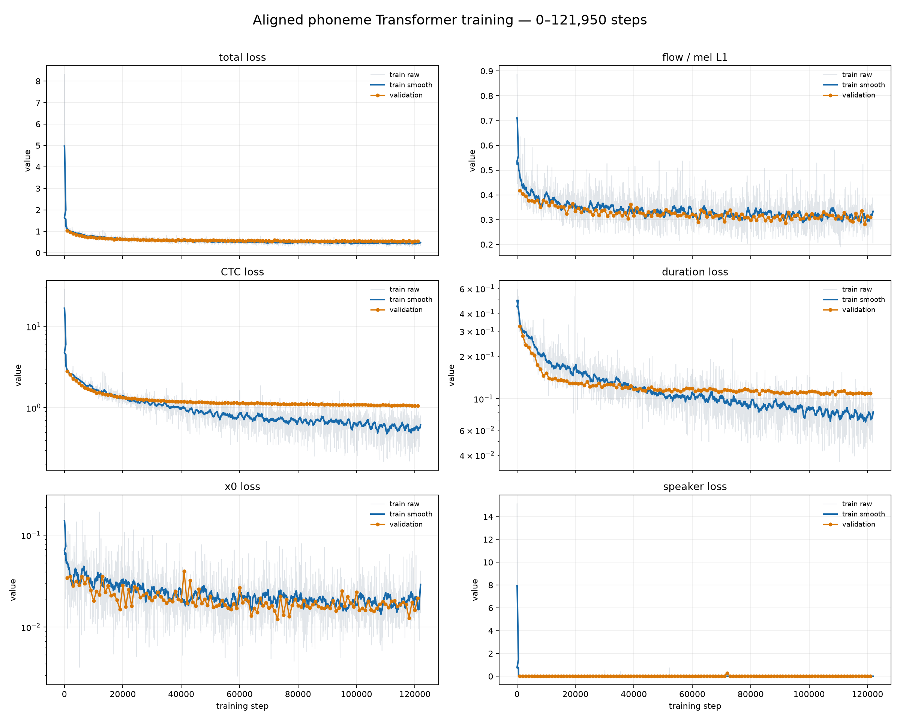

### Unseen: «Саша» и «Грека»

Здесь впервые появился результат, который имел смысл слушать как обобщение. В один тест вошли фразы:

```text
Саша шла по шоссе.
Ехал Грека через реку, видит Грека — в реке рак.
```

Aligned-модель смогла сформировать для них речь-подобный русский контур. Ordinary grapheme Transformer в сопоставимом тесте звучал намного хуже — как инопланетный музыкальный инструмент. Aligned-модель всё ещё была недообученной, хриплой и «пьяной», но впервые было ясно: phoneme/alignment path может обобщать содержание, а не только воспроизводить знакомый шаблон.

Послушать одну и ту же unseen-фразу:

- [Aligned 122k: Geralt, «Саша шла по шоссе»](/static/papers/witcher_tts/static/witcher_tts/samples/nonstandard_compare_aligned_54k_vs_raw_128k/aligned_122k_geralt_sasha.wav)
- [Ordinary 128k: Geralt, та же фраза](/static/papers/witcher_tts/static/witcher_tts/samples/nonstandard_compare_aligned_54k_vs_raw_128k/ordinary_128k_geralt_sasha.wav)
- [Aligned 122k: Geralt, «Грека/рак»](/static/papers/witcher_tts/static/witcher_tts/samples/nonstandard_compare_aligned_54k_vs_raw_128k/aligned_122k_geralt_greka.wav)
- [Aligned 122k: Yennefer, «Саша шла по шоссе»](/static/papers/witcher_tts/static/witcher_tts/samples/nonstandard_compare_aligned_54k_vs_raw_128k/aligned_122k_yennefer_sasha.wav)

Именно эту ветку мы зафиксировали как базу для следующего вопроса: можно ли к уже работающему text-to-speech добавить просодию.

## 9. Text-conditioning ablation: текст не игнорируется полностью

На frozen raw Transformer 100k и затем на 123k мы провели text-conditioning ablation — проверку зависимости модели от текстового условия без переобучения. Для каждого validation sample один раз фиксировали `target_mel`, noise, `t` и `speaker_id`, строили один и тот же `x_t`, а затем меняли только текст. То есть это не три разных аудио и не три разных seed, а один и тот же acoustic state с тремя вариантами content condition.

```text
A: правильный русский текст
B: текст другой реплики
C: пустой текст/PAD
```

В noise-dominant зоне зависимость от текста была такой:

| checkpoint | shuffled против correct | blank против correct |
|---|---:|---:|
| 100k | +11,69% | +16,60% |
| 123k | +14,19% | +20,87% |

В target-dominant зоне разница была почти нулевой, что ожидаемо: там сам `x_t` уже содержит много информации о target. В зоне шума текст начинал играть роль, но эффект всё ещё был умеренным.

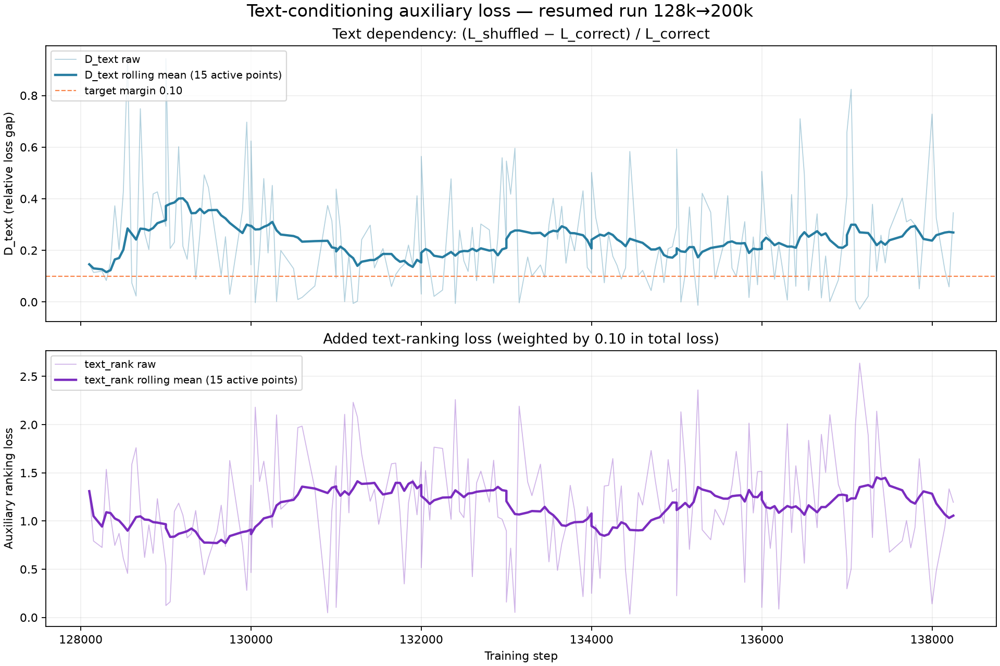

Слух подтвердил численный сигнал частично: `correct` можно было связать с входной фразой по структуре — ритму, длине, расположению частей. Но полноценной разборчивой речи не было. Вариант с текстом «ни хера» связать с аудио было невозможно. `blank` звучал тихо, с хрипением и вздохами.

Важная деталь: в этом тесте всем трём вариантам намеренно задавали одинаковые 531 mel-кадр, поэтому все выходы длились около 5,66 секунды. Это не означало, что модель выучила одинаковую длительность всех фраз; это было условие эксперимента.

- [correct: правильный русский текст](/static/papers/witcher_tts/static/witcher_tts/samples/text_conditioning_ablation_123k/geralt_correct.wav)
- [shuffled: текст другой реплики](/static/papers/witcher_tts/static/witcher_tts/samples/text_conditioning_ablation_123k/geralt_shuffled.wav)
- [blank: без текстового условия](/static/papers/witcher_tts/static/witcher_tts/samples/text_conditioning_ablation_123k/geralt_blank.wav)

### Почему auxiliary `D_text` не решил проблему

Это был отдельный контроль raw-ветки, проведённый до перехода к aligned-модели; он не являлся продолжением aligned training. Его задача была диагностической: понять, использует ли уже обученная raw-сеть правильный текст, а не решить произношение.

Добавили:

```text
D_text = (L_shuffled - L_correct) / L_correct
```

и ranking-loss, требующий, чтобы correct-текст давал меньшую ошибку, чем shuffled. Это действительно усиливало различие условий, но не обучало соответствию «данная фонема → данный участок mel». В raw Transformer не было явного text-to-frame alignment, а duration head не управлял акустическим путём. После этой диагностики raw-ветку не объявляли решением: именно её ограничения стали причиной перехода к aligned phoneme Transformer в следующей главе.

Итог: `D_text` оказался хорошей диагностической метрикой, но плохой заменой произношению. Можно научить модель предпочитать правильный текст на одном и том же `x_t`, не научив её произносить слова.

На этом месте TTS ещё не был решён. Просодию мы подключили не как заявление «базовая речь готова», а как отдельный исследовательский вопрос поверх единственной ветки, которая уже показала перенос на unseen-текст. Нужно было проверить, способен ли receiver принять дополнительный temporal control, не подменяя русский content path. Отрицательный результат этого эксперимента не отменял нерешённость базовой речи; он уточнял, что просодия не является быстрым обходом этой проблемы.

## 10. Просодия: что именно хотели получить

Следующая задача была сложнее: иностранная дорожка должна подсказывать русской модели интонацию, но не содержание.

План выглядел так:

```text
русские фонемы + русский speaker ID + EN/PL reference audio
                           ↓
             русская речь с интонацией reference
```

Мы пробовали не интерпретировать готовые latent-координаты вручную, а использовать готовые решения для кодирования аудио: FACodec/NaturalSpeech 3, Plachtaa FAcodec 50k и MSR-Codec.

### Что показали codec-эксперименты

На одинаковых синтетических фразах «Саша» и «Грека» сравнивали два типа пар:

- один текст, разные голоса;
- один голос, разные тексты.

FACodec V2 показал, что continuous content latent заметно ближе для одинакового текста (`0.798` против `0.385`). Plachtaa FAcodec 50k лучше разделял timbre: для same speaker/разных текстов cosine был около `0.736`, а для разных speakers/одного текста — около `-0.120`. MSR-Codec также имел отдельный semantic stream: одинаковый текст давал `0.2527`, разные тексты у одного speaker — `0.0325`.

Это было полезно для понимания разложения, но не готовым prosody-модулем. Непрерывные prosody streams были нестабильны и смешивали голос, содержание и акустические детали. Дискретные codebook ID нельзя было трактовать как простую координатную шкалу «эмоция». Поэтому FAcodec/MSR использовали как исследовательский микроскоп, а не как финальную TTS-архитектуру.

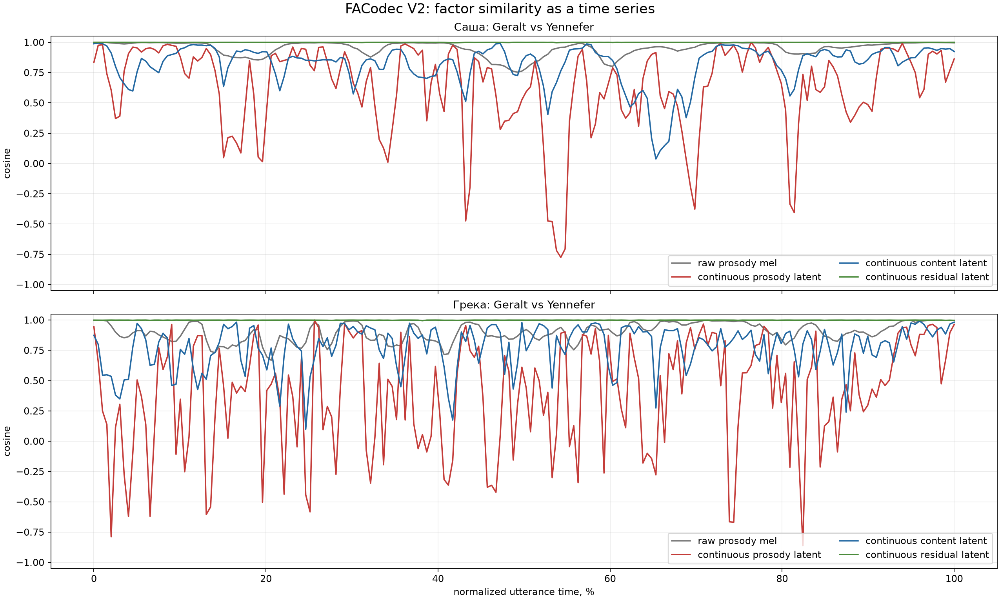

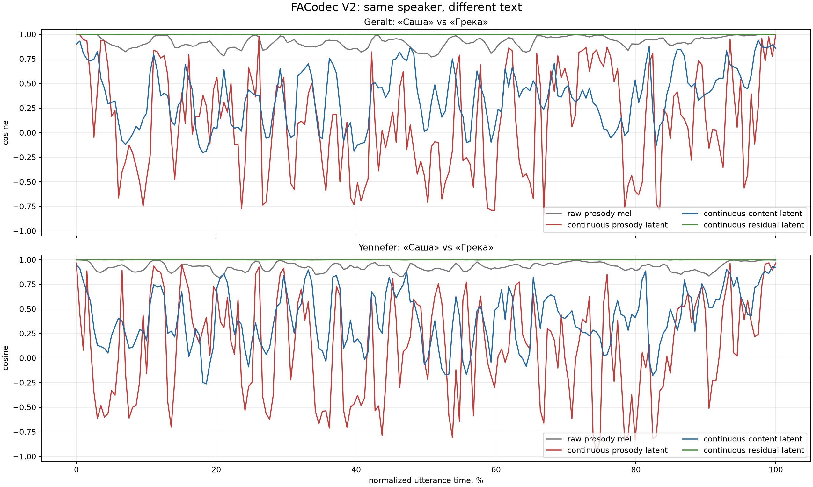

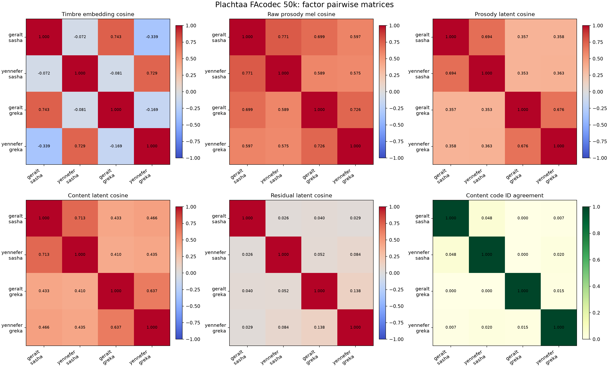

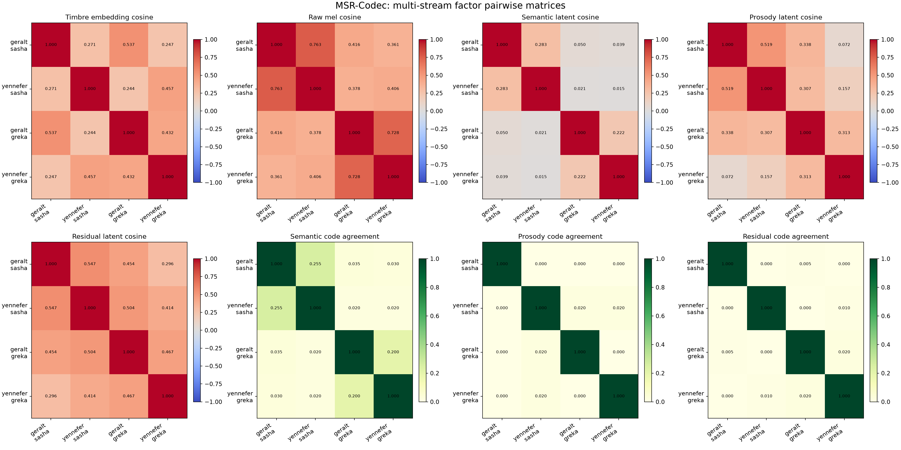

Главный вывод этого этапа: content и timbre у готовых кодеков действительно могут быть представлены раздельными потоками, но «prosody» не превращается автоматически в чистую, удобную и переносимую шкалу эмоций.

## 11. Prosody translator: 4M и 8M

Для полноценного переноса была собрана отдельная модель `AlignedProsodyTranslator`. В неё подавались нативные временные `prosody_codes` Plachtaa FAcodec для английских, польских и русских реплик. На один файл приходился не один глобальный вектор, а последовательность кодов во времени; основной кэш хранил только prosody stream как `uint16` плюс метаданные. Это было сделано именно для того, чтобы не придумывать ручную интерпретацию осей.

Полный multilingual cache содержал 64 122 NPZ-файла. Первая модель имела 4,2M параметров и обучалась 30k шагов:

| метрика | шаг 1000 | шаг 30000 |
|---|---:|---:|
| validation loss | 5,6401 | 5,3704 |
| accuracy | 4,64% | 6,69% |
| top-5 accuracy | 14,72% | 18,06% |
| perplexity | 281,5 | 214,9 |

Снижение loss составило около 4,8%, а в конце возникло плато. Затем сделали чистый контроль на 8M параметров, не меняя dataset, objective, optimizer и число шагов. Итоговый validation loss — `5.3643`, то есть практически то же самое.

Frozen ablation показал:

| модель | correct | shuffled | blank | D shuffled |
|---|---:|---:|---:|---:|
| 4M | 5,37110 | 5,38914 | 5,38423 | 0,336% |
| 8M | 5,36472 | 5,38266 | 5,44153 | 0,334% |

Восьмимиллионная сеть слегка чувствовала наличие входного потока, но почти не реагировала на перестановку *конкретной* временной просодии. Это не похоже на настоящий перенос интонации. Переход с 4M на 8M оказался не решением: bottleneck был не в размере, а в представлении/задаче и в слабом контроле над target prosody.

График translator-ветки:

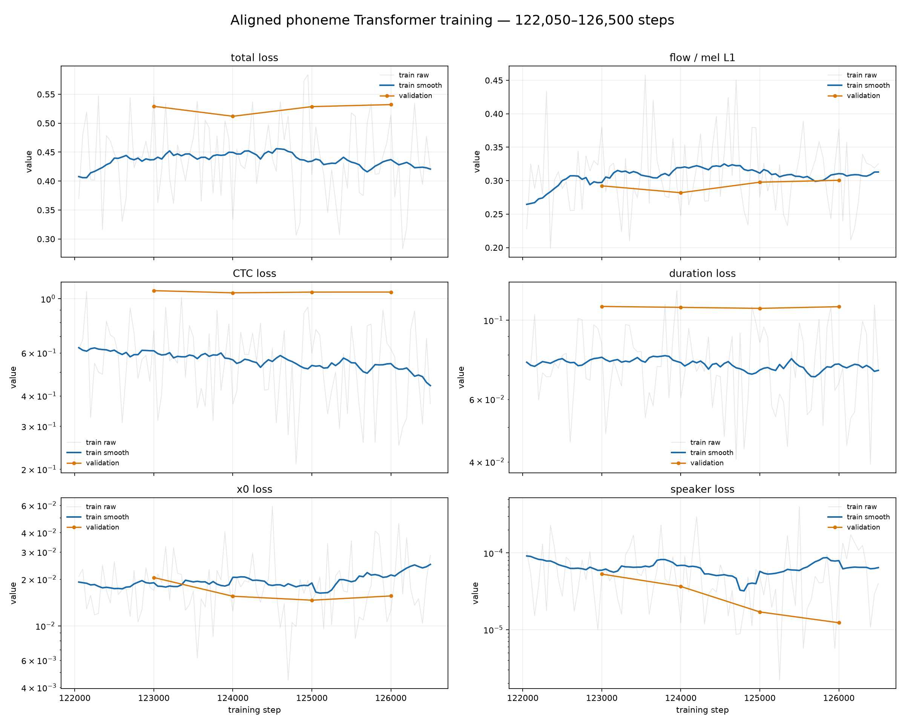

## 12. Native prosody receiver: влияние было, но не то

Пока translator не доказал перенос, мы проверили принимающую сторону отдельно. Взяли чистый aligned checkpoint около 122k, который ещё не обучался на prosody, и подключили к нему русский prosody-cache. Это был правильный контроль: не использовать уже «загрязнённый» checkpoint, где просодийная ветка могла заучить артефакты.

Введён reference-ranking loss: при одинаковых target, noise, `t`, text и speaker correct reference должен давать меньшую flow-ошибку, чем shuffled reference. На 9000 шагах validation `D_ref` достигал `26,05%`.

Что именно подавалось как reference: не WAV и не готовая метка «грусть/радость». Из каждой RU/EN/PL записи заранее извлекалась нативная последовательность дискретных `prosody_codes` Plachtaa FAcodec — примерно по одному `uint16`-коду на временной кадр. Коды проходили через embedding и prosody-adapter; длина выравнивалась по temporal axis через padding/mask к mel-представлению target. В `correct` использовалась последовательность той же реплики, в `shuffled` — последовательность другой реплики, в `blank` — отсутствие reference-кодов. Русский текст оставался phoneme-последовательностью, speaker ID — русским целевым героем. Поэтому `D_ref` измерял чувствительность flow к последовательности кодов, но не качество распознавания эмоции и не процент перенесённой интонации.

На слух результат был важнее цифры:

- `correct` и `blank` часто звучали почти одинаково;
- `shuffled` заметно менял манеру речи — вплоть до ощущения «говорит с трибуны» и грузинского акцента;
- в другом тесте влияние проявлялось главным образом как изменение громкости, а не как перенос локальной интонации.

То есть reference-ветка не была мёртвой. Но она извлекала побочный глобальный стиль и артикуляционный шаблон, а не устойчивую локальную просодию. Поэтому высокий `D_ref` нельзя переводить в «26% интонации».

Короткая контрольная тройка:

- [correct: исходная просодия](/static/papers/witcher_tts/static/witcher_tts/samples/local_prosody_9000_grid_geralt_contrast/geralt_correct.wav)
- [shuffled: чужая просодия](/static/papers/witcher_tts/static/witcher_tts/samples/local_prosody_9000_grid_geralt_contrast/geralt_shuffled.wav)
- [blank: без просодийного условия](/static/papers/witcher_tts/static/witcher_tts/samples/local_prosody_9000_grid_geralt_contrast/geralt_blank.wav)

## 13. Frankenstein-просодия: MFA, F0, energy, pause

Чтобы сделать управление более прозрачным, собрали практический модуль из готовых компонентов и временных рядов:

- MFA — границы фонем и слов;
- F0 — высота тона на voiced-кадрах;
- energy — энергия/громкость;
- voicing/pause — наличие голоса и интервалы тишины.

Важно, что MFA привязывает фонемы к mel-кадрам. Без этого нельзя сказать модели: «растяни именно звук `ё` в слове “всё”». Если просто изменить текст на `всееее`, фонемизатор и duration path не обязаны интерпретировать это как длительность одной фонемы.

### Что удалось сделать

На старой rank-loss модели карикатурные тесты доказали, что локальная длительность действительно управляется. В исправленной версии мы задали ударную `ˈɵ` в слове «всё» примерно на 0,5 секунды.

Послушать:

- [контроль: исходная просодия + MFA-пауза](/static/papers/witcher_tts/static/witcher_tts/samples/mfa_duration_rankloss_34500_focus_prosody_control_v3_ves/geralt_source_prosody_mfa_duration.wav)
- [растянутая «ё» в «всё»](/static/papers/witcher_tts/static/witcher_tts/samples/mfa_duration_rankloss_34500_focus_prosody_control_v3_ves/geralt_source_prosody_focus_emphasis_0_5s.wav)
- [растяжение + тихий хвост](/static/papers/witcher_tts/static/witcher_tts/samples/mfa_duration_rankloss_34500_focus_prosody_control_v3_ves/geralt_source_prosody_focus_emphasis_0_5s_whisper_tail.wav)

Пользователь подтвердил: `ё` действительно растягивается. Это был реальный и локальный эффект. Но усиление акцента через F0/energy было слабым, а quiet-tail распространялся шире заданного участка и в основном проявлялся как падение громкости.

### Почему F0 не стал магической метрикой

F0 — это не «эмоция» и не голос отдельного актёра. Он зависит и от говорящего, и от конкретной фразы, и от вокализации. Если напрямую заставлять русскую модель повторять F0 иностранного актёра, можно перенести не только интонационный контур, но и часть его физиологии.

Поэтому F0 нельзя было просто объявить главным target. В итоге более полезными для первой версии оказались временные границы, energy и voicing/pause, а F0 использовали только как диагностический канал, а не обязательный источник истины.

### Local и gated варианты

Глобальный prosody memory оказался слишком свободным: acoustic cross-attention сам выбирал, где использовать вход, и локальный сигнал расползался по фразе. Поэтому сделали local continuous branch, затем gated/FiLM вариант с независимыми каналами и отдельным `pause_silence_loss`.

Карикатурный тест на local-модели был слышен: `bounce`, `question` и `staccato` меняли окраску, энергию и манеру. Но каналы были entangled:

- F0 иногда воспринимался как изменение энергии;
- energy мог превратить паузный хрип в «ээээ»;
- pause действительно создавал границу тишины, но сама тишина заполнялась хрипом/дыхательным шумом;
- умеренные channel-isolation варианты давали почти микроскопические изменения.

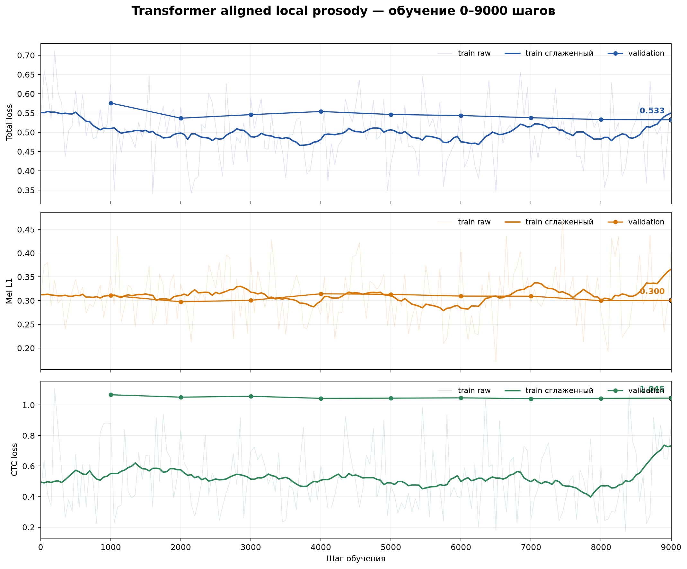

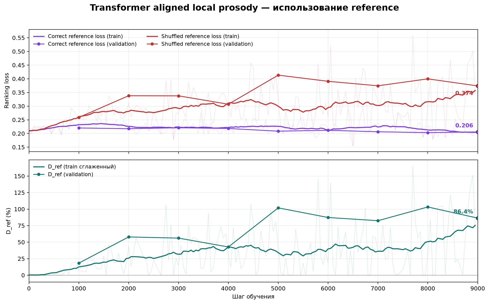

Главный слуховой результат: интонация менялась достаточно сильно, но чистого, локального и предсказуемого контроля не было. Старый rank-loss checkpoint в карикатурном растяжении даже оказался лучше нового MFA-duration adapter: добавленный conditioner начал конфликтовать с уже выученным duration prior.

## 14. Большая модель и большой корпус: 150M

После анализа стало понятно, что у 46M-модели есть сильный speech prior, но просодийные доработки не могут полностью перестроить его. Тогда подготовили отдельный scaling-пилот:

- около 151,4M параметров;
- 64 speaker-группы;
- все группы с русской речью более 10 минут;
- `unknown` исключён, `mirror` включён;
- float32 mel-cache;
- aligned/gated local-prosody архитектура;
- цель 100k шагов.

Это был чистый запуск с нуля, а не продолжение 46M: ширины и число speaker-классов изменились, поэтому частичная загрузка старых весов дала бы нечистое сравнение.

### Joint speech + prosody

На первых 18k шагов joint-модель быстро подхватила дешёвые prosody-признаки, но основная акустика отставала. На validation 18k:

```text
total      1.043
mel-L1     0.4307
CTC        2.417
duration  0.2415
x0         0.0362
```

При прослушивании пользователь услышал не речь, а рык льва; при этом сравниваемый голос практически не менялся. Это стало важным предупреждением: низкий speaker-loss не равен слышимому голосу, а быстро падающий prosody-loss не равен полезной просодии. Послушать: [Geralt, joint 150M, neutral](/static/papers/witcher_tts/static/witcher_tts/samples/current_150m_listen/geralt_neutral.wav) и [Yennefer, joint 150M, neutral](/static/papers/witcher_tts/static/witcher_tts/samples/current_150m_listen/yennefer_neutral.wav).

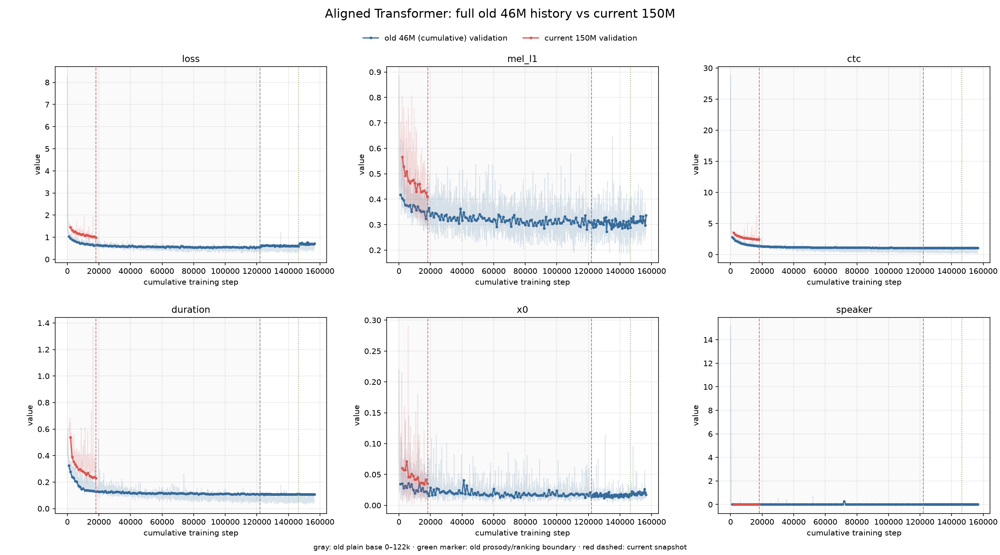

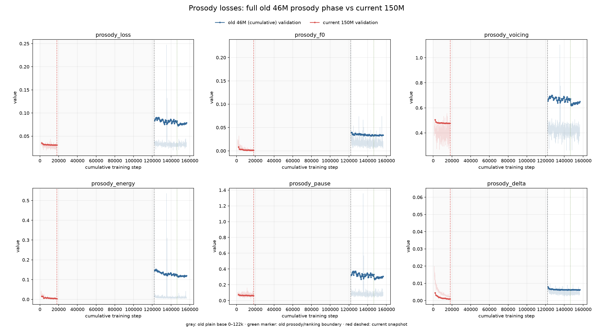

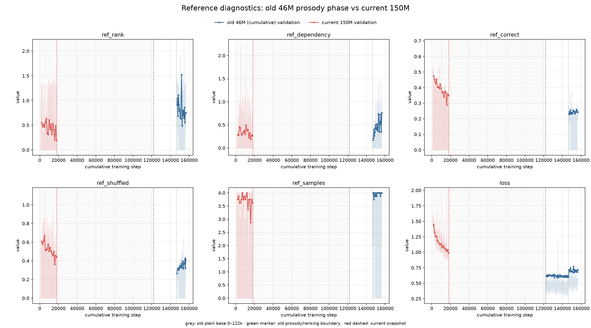

### Speech-first rescue

Чтобы отделить влияние просодии от общей акустики, запустили speech-only ветку той же 150M архитектуры на том же 64-speaker корпусе. Prosody-модули присутствовали в checkpoint, но их objective отключили. Это сохранило возможность подключить просодию позже и одновременно проверило, мешала ли она учить речь.

На 30k с нуля validation была примерно такой:

```text
total      0.8961
mel-L1     0.3737
duration  0.2207
x0         0.0360
CTC        2.4117
```

После rescue fine-tune от speech-only checkpoint до 30k:

```text
total      0.7019
mel-L1     0.3389
duration  0.1420
x0         0.0169
CTC        1.7017
```

Рык почти ушёл, но речь всё ещё оставалась плохой. На следующем rescue до точки 29k макродлительность фонем уже выглядела нормально, однако соседние звуки резко переключались друг в друга: не было естественной межфонемной coarticulation.

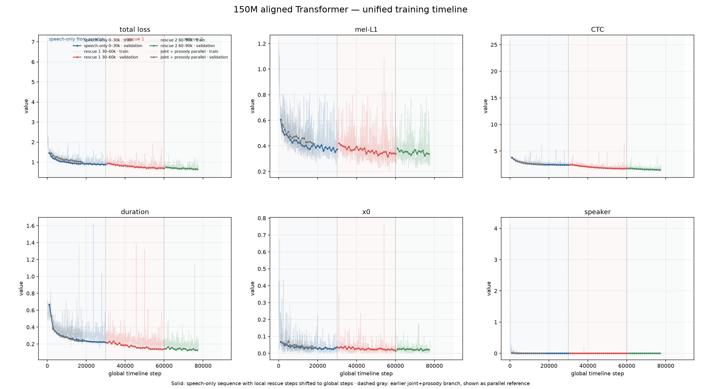

В targeted A/B проверили `predicted`, MFA и CTC-oracle alignment с одинаковым noise seed. Для Geralt MFA и CTC-oracle звучали почти одинаково; predicted иногда неверно распределял локальное время. Для Yennefer три режима были почти неразличимы. Значит, одной заменой duration path проблему не решить.

- [150M speech-only rescue2: Geralt, matching](/static/papers/witcher_tts/static/witcher_tts/samples/speech_only_150m_rescue2_29k_known_text_grid/geralt_1_geralt.wav)
- [150M joint на 18k: Geralt, neutral](/static/papers/witcher_tts/static/witcher_tts/samples/current_150m_listen/geralt_neutral.wav)

После этого подготовили отдельный fine-tune с тремя добавками: MFA duration override, усиленный speaker classification и masked transition/delta loss. Но это уже был ремонт симптомов поверх сложной системы, а не доказанный новый baseline. До полноценной стабилизации этой ветки проект перешёл к проверке готовых моделей.

## 15. Что проверяли из готовых решений

### CosyVoice 3

CosyVoice 3 был выбран как готовая крупная TTS-система, чтобы не продолжать бесконечно чинить самодельный flow. Под него подготовили официальный формат parquet.

После восстановления русских WAV подготовка дала:

```text
train       30 146 записей, 34,03 часа
validation   1 655 записей,  1,91 часа
test         1 817 записей,  2,01 часа
64 speaker-группы
```

Официальный parquet занял около 11,2 GB. В этом эксперименте мы не делали fine-tune готовых весов CosyVoice: запускали обучение с нуля на архитектуре CosyVoice, используя подготовленный parquet и её штатный train-pipeline. Результат оказался неудовлетворительным: часть звуков редуцировалась, речь разваливалась. Обучение остановили. Это не доказательство, что предобученный CosyVoice вообще не умеет клонировать голос; это отрицательный результат именно нашей scratch-постановки на Witcher-корпусе.

### Что показал именно `CosyVoice3-checkpoint`

Отдельно проверили штатный `CosyVoice3-checkpoint` через веб-морду, то есть уже готовые режимы inference, а не scratch-training выше. Здесь проявились два разных и практически важных свойства.

**Режим «предобученный голос».** Подготовка такого голоса на большом корпусе действительно позволяет выбрать персонажа без короткого reference-файла, но результат не сохранил специфику исходного говорящего. Получался голос, похожий на нужного актёра, но не тот самый голос. Большой корпус в этом режиме дал устойчивый усреднённый профиль, а не точную копию персонажа.

**Zero-shot cloning.** Короткий референс, наоборот, давал очень похожий тембр и лучше передавал индивидуальность голоса. Но у режима почти нет явного контроля над тем, *как* произносится текст. Модель сама додумывала произношение: например, для написанного «все» могла сказать «всё». Результат был сильно reference-dependent: эмоция, темп и манера речи в исходном референсе заметно меняли синтез, поэтому нейтральный и эмоциональный референсы нельзя было считать взаимозаменяемыми.

При swapping референсов получался дорогой набор почти похожих вариантов голоса одного и того же персонажа, а не один стабильный speaker embedding с независимым управлением интонацией. То есть готовый checkpoint хорошо закрывал задачу «сделать голос похожим по короткой записи», но не закрывал задачу «произнести заданный русский текст нужным русским актёром и отдельно управлять способом произнесения». Это ровно разделение, которого не хватало нашим самодельным моделям: CosyVoice лучше решал timbre, но оставлял произношение и просодию связанными с reference.

### ClearerVoice-Studio

ClearerVoice проверяли как готовый инструмент очистки и разделения речи. Во время речи остаточные шумы и мелодии отделялись плохо, поэтому для игровых реплик этот результат оказался неприемлемым.

### Deepdub

Был сделан короткий API-тест дубляжа локального видео с направлением `en-US → ru-RU`. До обработки видео API вернул HTTP 403: аккаунт не был допущен к Managed Dub. Поэтому это не модельный результат и не сравнение качества — просто не состоявшаяся попытка доступа к сервису.

### Seamless M4T v2 Large

Seamless M4T v2 Large установили как готовый baseline для speech-to-speech/translation, проверили русский output и локальную веб-морду. Система не клонировала голос исходного персонажа: она решала задачу перевода/синтеза своим голосом. Тестовый output получился слишком быстрым, местами с потерей содержания и смешением слов — «скороговорка» вместо дубляжа; примерно 30% слов на слух воспринимались как произнесённые по-английски.

Это был полезный отрицательный контроль: готовая multilingual-модель не заменяет TTS с сохранением конкретного русского актёра.

### ElevenLabs v2: внешний эталон, который попал в цель

Отдельно протестировали ElevenLabs v2 на переводе видео. В отличие от наших самодельных моделей, сервис дал именно то, что требовалось по результату: русский дубляж сохранял смысл и естественную просодию исходного ролика. Это важный контроль: задача в принципе достижима, а проблема нашего пайплайна не в том, что «перевод с интонацией» невозможен.

Послушать/посмотреть сохранившиеся файлы:

- [New project — ElevenLabs Russian dub](</static/papers/witcher_tts/static/external/New project_ru_dubbed.mp4>);
- [исходный 20-секундный фрагмент](</static/papers/witcher_tts/static/external/The Legendary Hero is Dead - Opening Shinda - 20s.mp3>);
- [русский дубляж 20-секундного фрагмента](</static/papers/witcher_tts/static/external/The Legendary Hero is Dead - Opening Shinda - 20s_ru_dubbed.mp3>).

По счётчику аккаунта 20 секунд второго теста стоили около 4500 токенов из 10 000 бесплатных. Отображавшиеся пакеты оценивались так: `$6` — 30k токенов/2:13 аудио, `$22` — 121k/8:58, `$99` — 600k/44:27, `$299` — 1,8M/2:13:20, `$990` — 6M/7:24:27. Для нашей задачи это экономически непригодно как постоянный backend, но как эталон качества ElevenLabs оказался самым сильным из проверенных вариантов.

## 16. Почему мы в итоге забили

Мы остановили не потому, что просодия совсем не работала. Наоборот, к концу было доказано несколько вещей:

1. Правильный aligned phoneme Transformer может переносить текст на unseen-фразы. Именно он первым дал не просто тембр, а речь-подобный русский контур для «Саши» и «Греки».
2. Reference/prosody-вход реально влияет на output. Он способен менять энергию, окраску, длительность и паузные границы.
3. MFA-duration path действительно может локально растянуть конкретную фонему — например, `ё` в «всё».
4. Vocos и базовый mel frontend были проверены oracle-тестом и не являются причиной «зомби»-звука.

Технические сбои по дороге — OOM, неверные чекпойнты, teacher-forcing leakage, неудачные кеши — были проблемами реализации. Мы их исправляли или изолировали и не считаем самостоятельной причиной остановки. Причины остановки были содержательными:

- модели научились выдавать речь-подобный звук, а некоторые — вполне узнаваемые фразы, но качество упёрлось заметно ниже продового уровня и не улучшалось пропорционально дальнейшему fine-tune;
- мы так и не определили, что такое «настоящая просодия» в виде устойчивого машиночитаемого target. Получилась лишь грубая смесь временных границ, energy, voicing/pause и F0, причём она была частично speaker- и content-dependent;
- масштабирование raw/aligned Transformer с примерно 44M до примерно 150M не дало ожидаемого улучшения. На практике 150M joint-модель сначала оказалась хуже по слышимой речи, а получение хотя бы сопоставимого качества потребовало отдельного speech-first rescue;
- после rescue качество стало лучше, но всё равно не приблизилось к продовому. Дальнейшее обучение выглядело уже не как «докрутить модель», а как отдельная многомесячная работа по новой акустической постановке;
- внешний эталон ElevenLabs показал, что желаемый результат возможен, но его стоимость делает постоянное использование сервиса для большого объёма дубляжа неприемлемым.

Именно поэтому ещё 100–200k шагов текущего objective не выглядели разумным продолжением. Они могли немного улучшить кривые, но не отвечали на главные нерешённые вопросы: как получить продовую разборчивость и как представить просодию так, чтобы сеть переносила её локально и предсказуемо.

## 17. Что осталось доказанным, а что нет

### Доказано

- правильный natural-log mel и Vocos работают;
- модель может учить speaker-зависимые акустические признаки;
- маленькие сети могут запоминать знакомые реплики;
- raw Transformer был лучше baseline по общему акустическому результату;
- aligned phoneme Transformer лучше ordinary Transformer обобщал на новые русские фразы;
- количество flow-шагов 12/32/64 не было главным bottleneck;
- text conditioning существует, но в грубой и слабой форме;
- MFA способен дать реальное управление длительностью конкретных фонем;
- prosody/reference-вход не игнорируется полностью;
- готовые codec-модели действительно выделяют content/timbre-подобные потоки, но не дают автоматически чистую переносимую просодию.

### Не доказано

- что текущая самодельная модель даёт приемлемое русское произношение;
- что speaker ID стабильно отделён от text prototype на полном корпусе;
- что английская или польская просодия корректно переносится в русскую;
- что рост с 46M до 150M сам по себе устранит «зомби»-артефакт;
- что дополнительные CTC, speaker, transition или ranking losses исправят acoustic prior без новой постановки обучения;
- что CosyVoice или Seamless в проверенных режимах решают именно нашу задачу «русский текст + русский актёр + иностранная интонация».

## 18. Что лежит рядом и как это слушать

Начинать прослушивание лучше в таком порядке:

1. [Aligned unseen «Саша»](/static/papers/witcher_tts/static/witcher_tts/samples/nonstandard_compare_aligned_54k_vs_raw_128k/aligned_122k_geralt_sasha.wav) — первый пример обобщения текста.
2. [Ordinary Transformer на той же «Саше»](/static/papers/witcher_tts/static/witcher_tts/samples/nonstandard_compare_aligned_54k_vs_raw_128k/ordinary_128k_geralt_sasha.wav) — контроль, почему aligned был важен.
3. [Text ablation: correct — правильный текст](/static/papers/witcher_tts/static/witcher_tts/samples/text_conditioning_ablation_123k/geralt_correct.wav), [Text ablation: shuffled — другой текст](/static/papers/witcher_tts/static/witcher_tts/samples/text_conditioning_ablation_123k/geralt_shuffled.wav), [Text ablation: blank — пустое условие](/static/papers/witcher_tts/static/witcher_tts/samples/text_conditioning_ablation_123k/geralt_blank.wav) — что именно означал слабый text signal.
4. [Prosody neutral](/static/papers/witcher_tts/static/witcher_tts/samples/local_prosody_5k_cartoon_prosody/geralt_neutral.wav), [bounce](/static/papers/witcher_tts/static/witcher_tts/samples/local_prosody_5k_cartoon_prosody/geralt_cartoon_bounce.wav), [question](/static/papers/witcher_tts/static/witcher_tts/samples/local_prosody_5k_cartoon_prosody/geralt_cartoon_question.wav) — доказательство, что просодийный вход способен менять манеру.
5. [Растяжение «ё» в «всё»](/static/papers/witcher_tts/static/witcher_tts/samples/mfa_duration_rankloss_34500_focus_prosody_control_v3_ves/geralt_source_prosody_focus_emphasis_0_5s.wav) — наиболее чистый локальный контроль.
6. [150M speech-only после rescue](/static/papers/witcher_tts/static/witcher_tts/samples/speech_only_150m_rescue2_29k_known_text_grid/geralt_1_geralt.wav) — почему улучшение loss ещё не стало естественной речью.
7. [150M joint на 18k](/static/papers/witcher_tts/static/witcher_tts/samples/current_150m_listen/geralt_neutral.wav) — отрицательный пример, где большая модель ушла в рык.

Все существенные численные результаты уже приведены в тексте рядом с соответствующими графиками и слуховыми примерами.

## Итог

Если без самоуспокоения: готовый TTS для продового дубляжа мы не получили. За неделю мы построили несколько работающих, но недостаточно качественных прототипов и точно выяснили, что простое увеличение числа шагов, loss или параметров не закрывает разрыв до результата. Это не «победа дружбы», а довольно дорогая диагностика границ текущего подхода.

```text
frontend/Vocos          исправен
speaker signal          частично обучается
text conditioning       есть, но грубое
phoneme alignment       дало первое обобщение
prosody control         слышимо работает, но entangled
foreign prosody transfer не доказан
natural speech quality  недостаточна
```

Проект остановлен по прагматичной причине: я потратил неделю и получил не финальный голос, а понимание, что доведение этой самодельной системы до чего-то внятного потребует, вероятно, полноценной работы в течение нескольких месяцев. Ещё один ночной прогон не изменил бы характер задачи. Возвращаться к проекту имеет смысл уже с новой acoustic-постановкой или с готовой TTS-моделью, у которой fine-tune и reference conditioning являются штатной частью метода.

